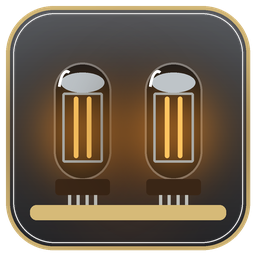
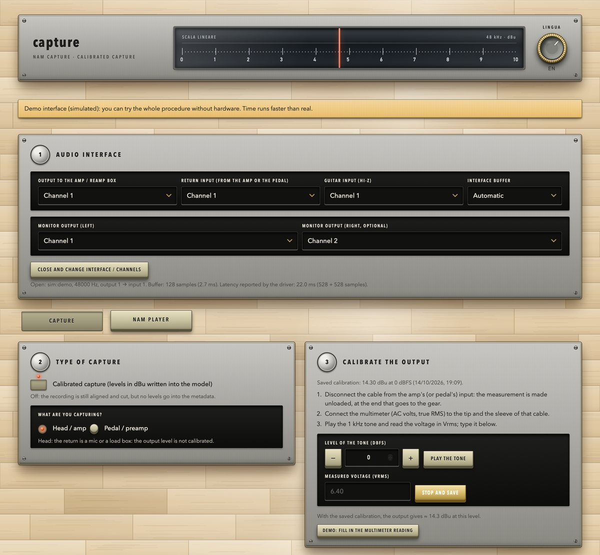
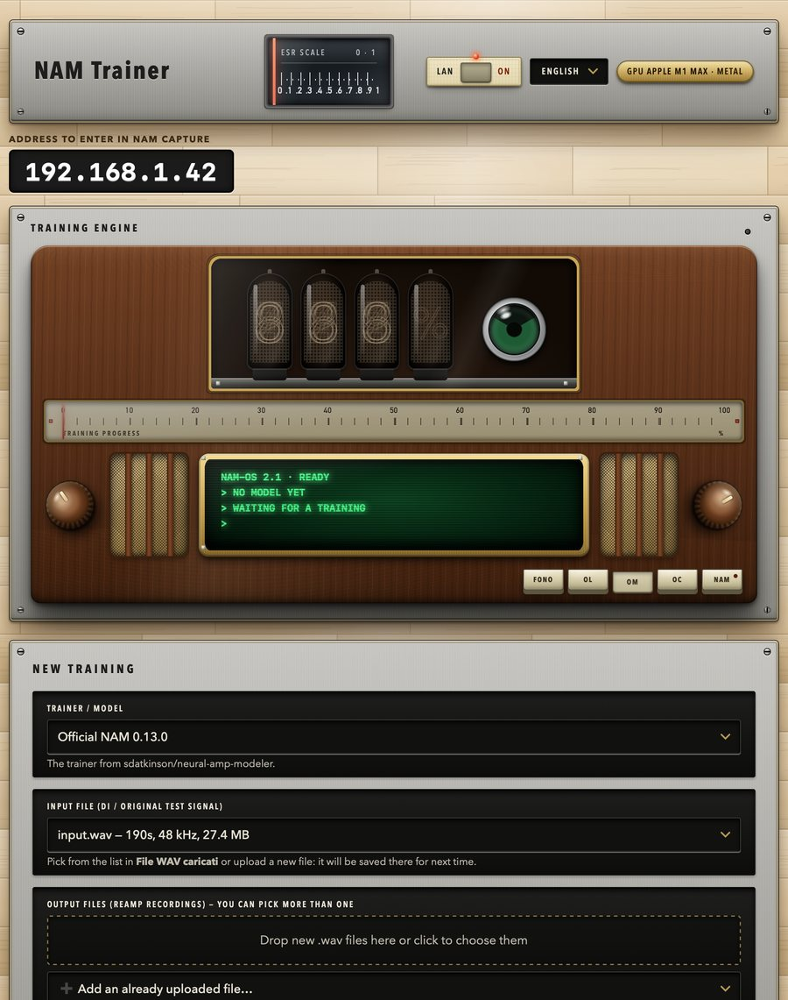
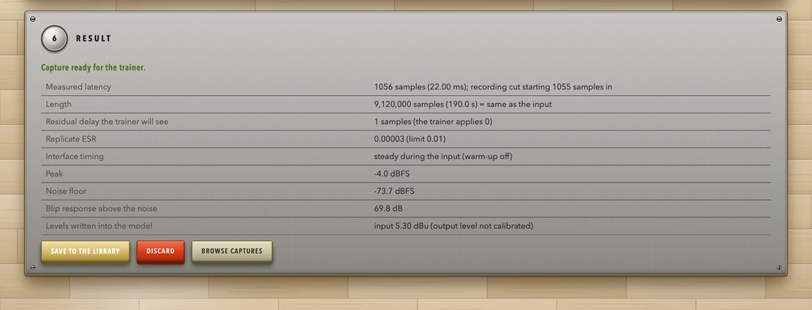
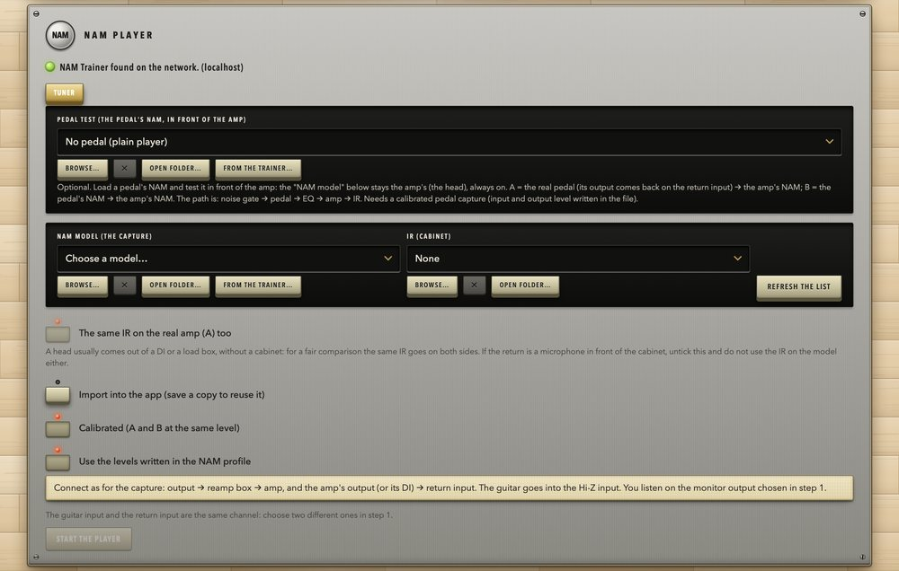

<h1 align="center">NAM Suite</h1>

<b>Train, capture and try <a href="https://github.com/sdatkinson/neural-amp-modeler">Neural Amp Modeler</a> profiles — two apps, one installer.</b>

   

<a href="../../releases/latest"><b>Download</b></a> &nbsp;·&nbsp; <a href="README.it.md">Italiano</a>

NAM Capture, here in its demo mode (a simulated interface). Screenshots are in English; both apps also speak Italian.

| | |
|---|---|
| **NAM Trainer** | A web page (opens from the system-tray icon on Windows, the menu bar on Mac) that trains NAM models on your NVIDIA or AMD GPU, the Apple GPU (Metal) — or just the CPU — with a queue, live progress, ESR and plots. Usable from the PC itself or from any device on your network. |
| **NAM Capture** | A calibrated **reamp capture** tool: it measures the levels of your audio interface in dBu, records the standard NAM test signal through your amp or pedal, checks and aligns the take, writes the levels into the model and sends everything to the Trainer. It also plays your models live: **NAM + IR test**, a **NAM player** with A/B against the real amp, a **pedal test** (pedal NAM in front of the amp's NAM) and a precise **tuner**. |

> **Windows and macOS.** Version 1.0 comes for Windows 10/11 and for Macs with Apple Silicon (training on the Apple GPU through Metal).

## A look

<table>
  <tr>
    <td width="42%" valign="top"> <b>NAM Trainer</b> - queue, live progress, ESR; here with a capture just received from NAM Capture</td>
    <td width="58%" valign="top">
       <b>NAM Capture</b> - the report of a take: latency, replicate ESR, peak, noise floor, the levels written into the model  
       <b>NAM Player</b> - A/B against the real amp, with the NAM and the cabinet IR
    </td>
  </tr>
</table>

## Download and install (Windows)

1. Open the **[Releases](../../releases)** page and download **all four files** into the **same folder**:
   `NAM-Suite-Setup.exe` and its three data parts `NAM-Suite-Setup-1.bin`, `-2.bin`, `-3.bin`
   (GitHub does not accept files over 2 GiB, so the installer is split).
   *Shortcut:* download only `Scarica-NAM-Suite.cmd` and double-click it: it downloads the four files, checks them and starts the setup.
2. Double-click `NAM-Suite-Setup.exe`. Choose the language and the components (Trainer, Capture, or both); the installer detects your graphics
   card and installs the right PyTorch (NVIDIA, AMD or CPU) **without needing internet**. Windows may warn about an unknown publisher
   (the files are not code-signed): *More info → Run anyway*.
3. Open **NAM Trainer** (it lives in the notification area) and **NAM Capture** from the Start menu or the desktop icons.

Check the downloads with `SHA256SUMS.txt` (same release page).

**Requirements:** Windows 10/11 64-bit, ~10 GB free while installing. For training: NVIDIA RTX 20-series or newer with driver 570+, *or* a
supported Radeon (RX 7000/9000, Adrenalin 26.2.2+, **experimental**: never tried by the authors on real hardware), *or* any PC (CPU only,
much slower). For NAM Capture: an audio interface with an **ASIO** driver, and a reamp box to capture amps and pedals.
The uninstaller removes everything (it first shows how many models, WAV files and captures it is about to delete and asks).

## Download and install (macOS)

1. Open the **[Releases](../../releases)** page and download `NAM-Suite-macOS.pkg` (about 440 MB) and `NAM-Suite-macOS.pkg.sha256`. Check the download:
   `shasum -a 256 -c NAM-Suite-macOS.pkg.sha256` in the folder where you saved them.
2. Open `NAM-Suite-macOS.pkg`. Choose the components (Trainer, Capture, or both); the apps go into `/Applications/NAM Suite/` and bring their own Python and
   PyTorch: nothing else to install, no internet needed.
3. The apps are signed ad hoc, not with an Apple Developer ID, so on the first launch macOS may say it cannot verify them: **right-click the app →
   Open** (once). NAM Capture asks for the **microphone permission** (it needs it to read your interface's inputs): allow it.
4. Open **NAM Trainer** (it lives in the menu bar) and **NAM Capture** from `/Applications/NAM Suite/`.

**Requirements:** a Mac with Apple Silicon (tested on macOS 15), about 1.5 GB free. Training runs on the Apple GPU (Metal). For NAM Capture: any audio
interface Core Audio can see (inputs and outputs on the same device, at 48 kHz) and a reamp box to capture amps and pedals.
`Disinstalla NAM Suite` (in `/Applications/NAM Suite/`) removes everything: it first shows how many models, WAV files and captures it is about to delete and asks
(the default answer is "No").

## What is in this repository

| Path | What |
|---|---|
| `trainer/` | NAM Trainer: FastAPI server and web page (`nam-web/`), the two trainers it can run (`trainers/`: the official `neural-amp-modeler` and *NAM Trainer Reloaded*, unmodified, with their licenses), tests |
| `capture/` | NAM Capture: Python server and web page (`capture_tool/`), real-time C++ audio engine (`native/`), the Windows shell (Win32 + WebView2 + ASIO) and the macOS shell (Swift + WebKit + Core Audio, `packaging/`), tests |
| `suite/` | The installer: `build.py` (stages Python, packages and both apps), `installer/NAMSuite.iss` (Inno Setup), the .NET tray launcher (`launcher/`), the macOS build and package (`macos/`), pinned package lists (`locks/`) |

Tests: `python -m unittest discover -s trainer/tests` and `python -m unittest discover -s capture/tests`; the C++ engine's own tests: `capture/native/run_tests.bat`.

### Build the Mac package yourself

Needs a Mac with Apple Silicon and the Xcode Command Line Tools. `bash suite/macos/build_mac.sh all` (it downloads the pinned Python, PyTorch and the .NET SDK into `suite/cache`, nothing is installed in the system) builds both apps and `NAM-Suite-macOS.pkg` in `suite/output`.

### Build the Windows installer yourself

Needs Windows with Python 3.12, Visual Studio Build Tools (C++), Inno Setup 6, and the free [Steinberg ASIO SDK](https://www.steinberg.net/developers/)
(**not included**: Steinberg's license does not allow redistributing it; see `capture/native/third_party/ASIO_SDK_SETUP.md`).
Then `build-installer.cmd all` (the first run downloads ~5.5 GB of pinned packages; the installer lands next to the repository).

## Credits and license

The code of NAM Suite is released under the **MIT License** ([LICENSE](LICENSE)). It bundles, vendors and installs third-party software under
their own licenses — see [THIRD_PARTY.md](THIRD_PARTY.md): above all Steven Atkinson's [neural-amp-modeler](https://github.com/sdatkinson/neural-amp-modeler)
and [NeuralAmpModelerCore](https://github.com/sdatkinson/NeuralAmpModelerCore), SlamminMofo's NAM Trainer Reloaded, PyTorch, and the
[NAM-Oversampler](https://github.com/DLC86/NAM-Oversampler) tuner code. *ASIO is a trademark and software of Steinberg Media Technologies GmbH.*
This project is independent: it is not affiliated with, or endorsed by, the authors of Neural Amp Modeler, NVIDIA, AMD, Steinberg or Microsoft.
